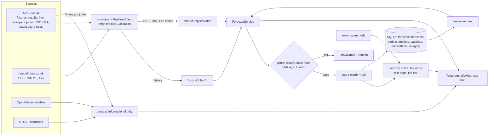

# How the blocks connect

**Probability path:** providers → (market-implied if ≥2 bookmakers quote 1X2 and O/U 2.5, else Dixon–Coles) → score matrix →
`/pick`. **Context path** (weather, lineups, injuries, headlines) is shown next to the forecast but does not change
probabilities: its effect is unvalidated, and fresh prices already include public information. Lineups matter indirectly —
once published, bookmaker prices move, and the next market-implied forecast reflects it.

## Failure behaviour per block
| Block | Failure | Result |
|---|---|---|
| Provider HTTP | 5xx/429/timeouts | backoff + jitter, breaker after 5 failures, message without key |
| History | < `MIN_TRAINING_MATCHES` or team < `MIN_TEAM_MATCHES` | forecast unavailable, reason shown |
| Market odds | stale, < 2 bookmakers, poor fit | Dixon–Coles only, flag shown |
| Live | feed older than `LIVE_STALE_SECONDS`, no minute/score | unavailable |
| Exact-score price | missing / below minimum | `no_price` / `no_bet` |
| EV gate | alerts disabled or backtest not passed | at most `candidate` |
| Context sources | any error | listed as unavailable; never invented |
